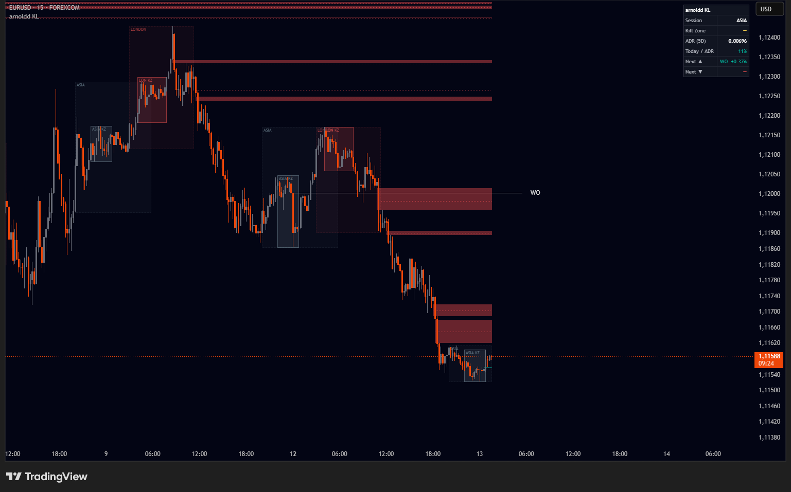
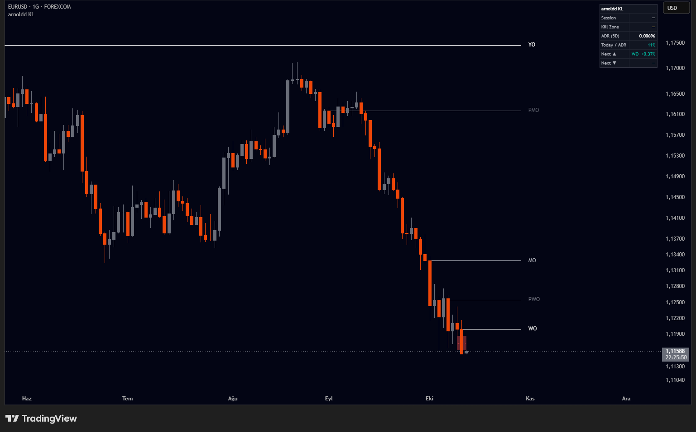

# arnoldd's Key Levels, Gaps & Kill Zones

A Pine Script v6 overlay for TradingView that puts the reference points an
intraday trader checks every morning on one chart: higher-timeframe opens,
previous highs and lows, session ranges and their liquidity, kill zones,
fair value gaps and opening gaps.

**Published on TradingView:** [Arnoldd's Tool: Key Levels, Gaps & Kill Zones](https://www.tradingview.com/script/DBvnSZIo-Arnoldd-s-Tool-Key-Levels-Gaps-Kill-Zones/)

*EURUSD 15m: session and kill zone boxes, unfilled fair value gaps with their midpoints, the weekly open, and the dashboard.*

*EURUSD daily: yearly, monthly and weekly opens with their previous-period counterparts.*

## Features

| Module | What it draws |
| --- | --- |
| **Sessions & kill zones** | Asia, London, NY AM and NY PM sessions as dotted boxes, kill zones as solid boxes, all with configurable times and colours |
| **Session liquidity** | When a session closes, its high and low extend right until price trades through them, then are marked swept |
| **Key levels** | Yearly, monthly, previous-monthly, weekly, previous-weekly and daily opens, NY midnight open, previous day and week high/low |
| **Smart merging** | Levels within an ATR-based tolerance collapse into one line with a combined label (`WO / PDH`) instead of stacking |
| **Gaps / FVG** | 3-candle fair value gaps, 2-candle price gaps, or both; minimum size filter, shrink on partial fill, midpoint (CE) line |
| **Opening gaps** | New Week and New Day Opening Gaps (NWOG / NDOG) with midpoint, keeping the most recent N |
| **Dashboard** | Active session and kill zone, 5-day ADR, today's range as % of ADR, nearest level above and below |
| **Alerts** | Level cross, session high/low sweep, new gap, kill zone open, all through a single `alert()` condition |

## Install

1. Open the [TradingView Pine Editor](https://www.tradingview.com/pine-script-docs/).
2. Paste [`src/arnoldd_key_levels.pine`](src/arnoldd_key_levels.pine) and click **Add to chart**.
3. For alerts, create one alert on the indicator with the condition
   **Any alert() function call**, then choose which events fire in the
   **Alerts** settings group.

Or add the published version from the link above.

## Design notes

**No future data.** Higher-timeframe opens are requested with
`lookahead_on` and no offset. That is safe because the open of the current
weekly or monthly bar is known from its first tick. Highs, lows and ADR are
requested with a `[1]` offset, so they only ever read completed bars. Session
highs and lows are built bar by bar from the chart itself.

**Session times in New York time.** The default session times follow the ICT
convention and are read in `America/New_York`, so they stay aligned through US
daylight-saving changes. v1.0 read them in a fixed UTC+3 timezone, which put
every session about seven hours early.

**Bounded state.** Gaps, session liquidity and opening gaps live in arrays with
user-set caps. The oldest entries are dropped and their drawings deleted, so
per-bar work stays constant on low timeframes instead of growing with chart
history.

**Sessions as objects.** Each session or kill zone is a `Session` object that
tracks its own range, extreme timestamps and open/close transitions. Liquidity
lines, alerts and the dashboard read from those objects, not from separate
state.

**Timeframe-aware levels.** A level is hidden when it means nothing on the
current chart, such as the daily open on a daily chart or the weekly open on a
weekly chart.

## Compliance check

The script is checked with `pine-audit`, a static
scanner for repainting, lookahead and TradingView House Rules issues. Current
result: no critical or high findings. The remaining low items are the
`lookahead_on` opens explained above.

## Changelog

See [CHANGELOG.md](CHANGELOG.md).

## License

[Mozilla Public License 2.0](LICENSE), the default licence for open-source
TradingView publications.
